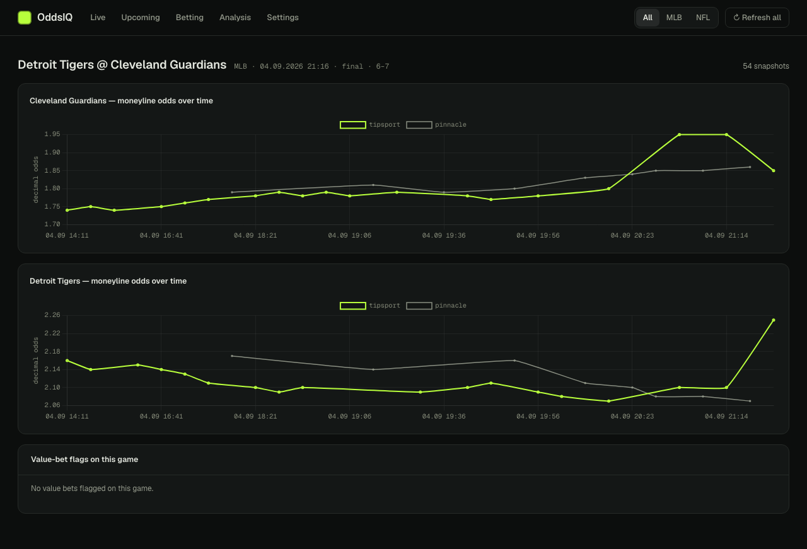

# OddsIQ

[](https://github.com/voita-duff/OddsIQ/actions/workflows/ci.yml)

OddsIQ compares the moneyline odds of a Czech bookmaker, Tipsport, against
Pinnacle, a low-margin bookmaker whose prices are a common reference for the
"true" probability of an outcome. When Tipsport pays more than Pinnacle's
vig-free price implies, the gap is recorded as a value bet, and every bet is
later graded by closing line value (CLV): did the market move towards the price
that was taken? I built it to find out, with real data rather than intuition,
whether a local bookmaker's prices lag the sharp market by enough to bet on.
It runs as an always-on async pipeline with a local dashboard, and has an
optional engine that places small bets through a browser extension.



*Dashboard drill-down for one game: Tipsport and Pinnacle odds as recorded over
the hours before the first pitch.*

## Architecture

```
 The Odds API                         Tipsport offer API
 (schedule, scores, Pinnacle odds)    (curl_cffi, Playwright for the Cloudflare challenge)
             \                              /
              PollCoordinator: per sport, cadence set by time to kickoff
                               |
     match games (team names, +/-2h start) -> remove Pinnacle vig -> EdgeService + integrity guards
                               |
          SQLite: games, odds snapshots, value bets, placed bets (forward-only migrations)
            /                  |                                  \
 SettlementService       FastAPI dashboard          BettingService -> WebSocket bridge
 (closing lines, CLV,    (read-only by default)     -> Chrome extension -> Tipsport bet slip
  results)
```

- Each sport is a `SportProfile` in [oddsiq/sports/profiles.py](oddsiq/sports/profiles.py), holding API keys, market IDs and team names.
- Polling tightens as kickoff approaches, and a budget governor slows Pinnacle requests to stay inside the monthly API quota.
- Integrity guards mark suspicious detections instead of dropping them: stale sharp prices, implausibly large edges, in-play listings and incomplete markets. They are stored but kept out of every report.
- The betting engine re-checks each bet just before placing it and stops itself after repeated failures. Hard caps on stake, bet count and daily loss are set in the environment, out of reach of the dashboard.
- More detail lives in the Obsidian vault under [docs/](docs/00%20-%20Map%20of%20Content.md). [HANDBOOK.md](HANDBOOK.md) is the operator's cheat sheet.

## Running it

Needs Python 3.11 or newer, `make`, and a key from [The Odds API](https://the-odds-api.com).

```bash
git clone https://github.com/voita-duff/OddsIQ.git
cd OddsIQ
python3 -m venv .venv
make install                 # editable install, dev tools, Playwright Chromium
cp .env.example .env         # then set ODDS_API_KEY in .env
make lint
make test
.venv/bin/oddsiq             # run the pipeline; Ctrl-C stops it and prints a summary
.venv/bin/oddsiq dashboard   # dashboard at http://127.0.0.1:8080
```

Every other setting in [.env.example](.env.example) is optional and documented
there. Auto-betting and the dashboard's write controls are off unless enabled
explicitly. [DEPLOY.md](DEPLOY.md) covers running it 24/7 with Docker Compose.

Other commands are listed by `.venv/bin/oddsiq --help`. They include a
per-bookmaker audit report, a Tipsport pre-flight check and the betting engine
controls.

## Status and known limitations

This is an evaluation project. The pipeline collected odds from April to
September 2026, which is the extent of the data I have.

What works:

- Collection, matching, edge detection, settlement and CLV tracking across five
  sport profiles. MLB and NFL are enabled in code. NBA and NHL are off until a
  fresh pre-flight check. WNBA is off after a full two-month season produced
  no value bets, because Tipsport's margin there exceeded every edge seen.
- The dashboard, the integrity guards and the database backups.
- The placement path from the betting engine to a confirmed Tipsport ticket.
  It was proven with one supervised test bet at a 10 CZK stake, triggered by
  hand rather than by a detection.

What does not work yet, or is not known:

- **Whether the edge is real.** Two data bugs were found and fixed along the
  way. Basketball was reading a three-way market as the moneyline, and MLB
  detections were matched to the next game of the same series. The affected
  rows are excluded, and no conclusion about profitability has been drawn yet.
- **Automated placement.** Every automated attempt in the recorded data was
  rejected because the extension could not find the offer on the page. The
  causes found so far, wrong-game listings and off-screen click targets, are
  fixed, but the fixes have not been confirmed on a live bet.
- **Narrow scope.** One soft bookmaker and moneyline markets only.
- **Fragile inputs.** Tipsport's offer API is undocumented and sits behind
  Cloudflare, so a site change can break collection without warning.
- **Platform.** The browser-actuator Docker image only builds for amd64.

What I would do next: confirm the placement fix on a live bet, re-enable NBA
and NHL after a pre-flight check, and finish the deferred resilience work. That
work is automatic recovery, log monitoring and season-boundary handling.

## Note on scraping

OddsIQ is a personal research project. This repository contains no bookmaker
credentials, sessions or scraped datasets, only a few small redacted page
fragments used as test fixtures. If you run it, you are responsible for
complying with the terms of the sites it accesses.

## Tech stack

- Python 3.11+, asyncio, httpx, curl_cffi, Playwright
- SQLite through aiosqlite, with forward-only migrations
- FastAPI, Jinja2, htmx and Chart.js for the dashboard
- Chrome Manifest V3 extension driving the page through the DevTools protocol, talking to the pipeline over WebSockets
- Docker Compose
- pytest, pytest-asyncio, pytest-httpx, ruff, GitHub Actions

## License

MIT. See [LICENSE](LICENSE). The dashboard ships minified copies of htmx
(Zero-Clause BSD) and Chart.js (MIT), which keep their own licenses.
